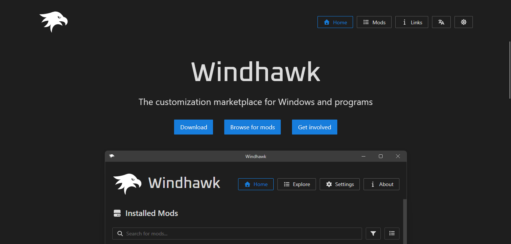
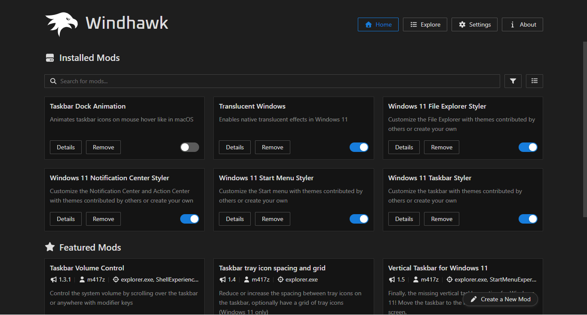
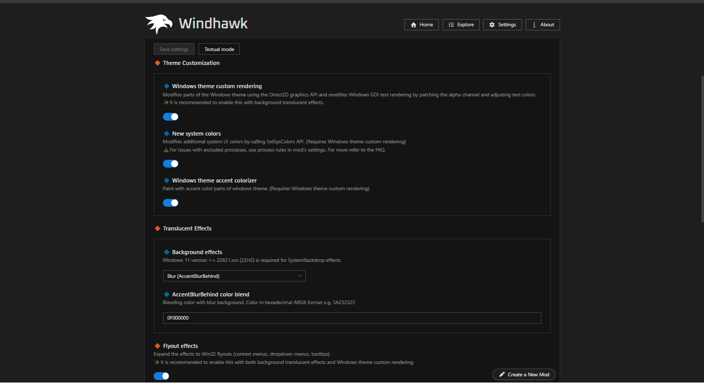
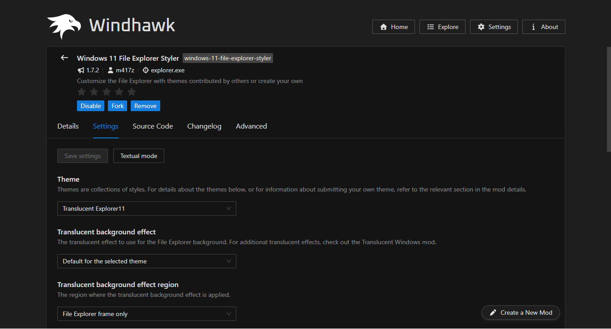
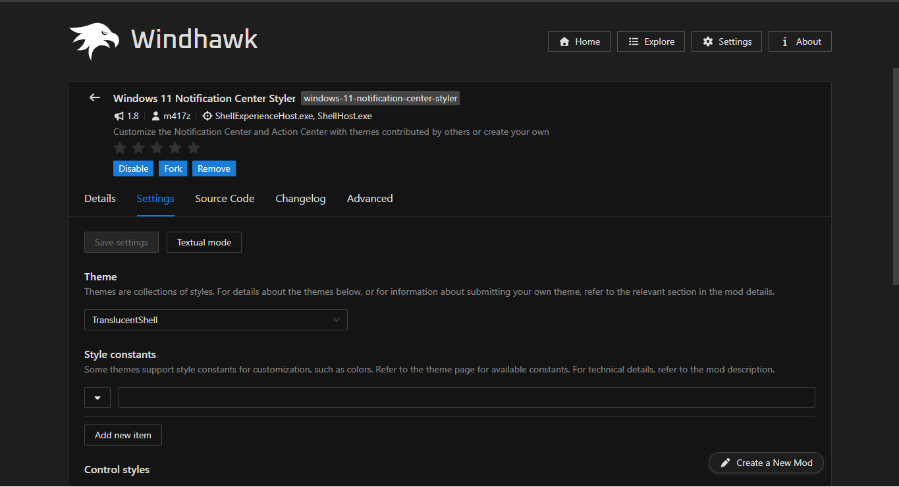
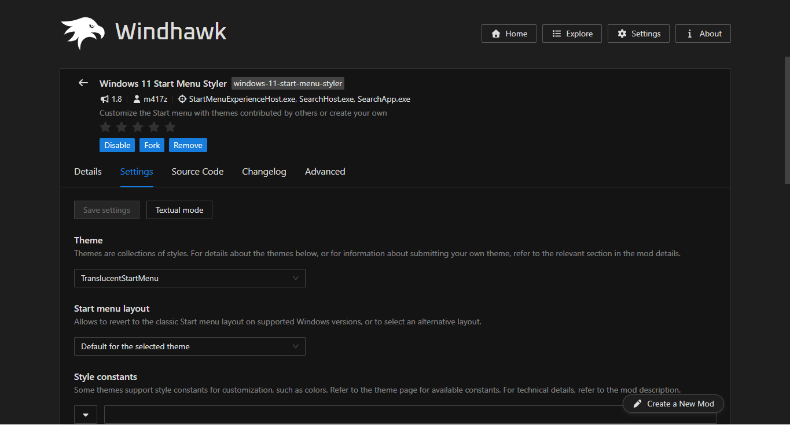
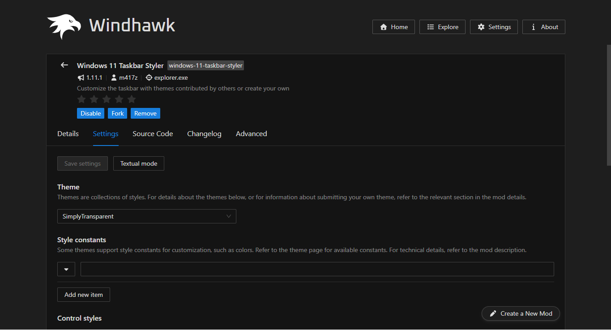

# Windhawk Blur Config

Este repositório reúne apenas configurações de efeitos **blur** e **vidro fosco** do Windows usando o Windhawk.

## Links

  

- [Baixar o instalador do Windhawk](https://ramensoftware.com/downloads/windhawk_setup.exe)

## Tutorial

### 1. Baixe e instale o Windhawk

Acesse o [site oficial](https://windhawk.net/) ou baixe o instalador pelo link acima. Execute o arquivo baixado e conclua a instalação.

### 2. Instale os mods

Abra **Explore**, procure cada mod listado abaixo e instale-o:

- **Translucent Windows** — efeitos translúcidos em janelas e menus.
- **Windows 11 File Explorer Styler** — temas para o Explorador de Arquivos.
- **Windows 11 Notification Center Styler** — temas para a Central de Notificações.
- **Windows 11 Start Menu Styler** — temas para o menu Iniciar.
- **Windows 11 Taskbar Styler** — temas para a barra de tarefas.

Depois, volte para **Home**. A imagem mostra os mods na seção **Installed Mods**. Ative cada mod pelo botão no cartão e selecione **Details** para configurar suas opções.

### 3. Configure o Translucent Windows

Abra **Details** no **Translucent Windows** e acesse **Settings**. Nesta etapa, a captura mostra as opções de renderização personalizada do tema, novas cores do sistema, cor de destaque e efeitos translúcidos. Para o fundo, selecione **Blur (AccentBlurBehind)**; o valor de cor exibido é `0F000000`. As opções disponíveis podem variar conforme a versão do Windows.

### 4. Configure o tema do Explorador de Arquivos

Abra **Details > Settings** no **Windows 11 File Explorer Styler**. Na opção **Theme**, selecione `Translucent Explorer11`. A captura também mostra o efeito de fundo padrão do tema e a região **File Explorer frame only**.

### 5. Configure a Central de Notificações

Abra **Details > Settings** no **Windows 11 Notification Center Styler**. Na opção **Theme**, selecione `TranslucentShell`. A imagem mostra a seleção do tema e a área **Style constants**, onde é possível ajustar constantes de estilo se o tema oferecer suporte.

### 6. Configure o menu Iniciar

Abra **Details > Settings** no **Windows 11 Start Menu Styler**. Escolha `TranslucentStartMenu` em **Theme**. A captura também mostra **Default for the selected theme** na opção **Start menu layout**; mantenha esse padrão ou escolha outra opção conforme sua preferência.

### 7. Configure a barra de tarefas

Abra **Details > Settings** no **Windows 11 Taskbar Styler** e escolha `SimplyTransparent` em **Theme**. A imagem mostra também a seção **Style constants**, que pode ser usada para personalizar o tema quando houver opções disponíveis.

### 8. Salve e confira

Depois de configurar cada mod, selecione **Save settings** quando o botão estiver disponível. Volte para **Home** e confira se os mods desejados continuam ativados. Você pode retornar às configurações para trocar os temas ou desativar um mod a qualquer momento.
